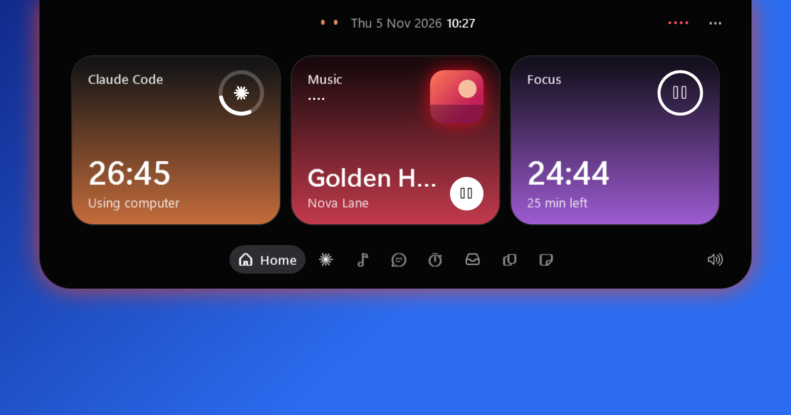
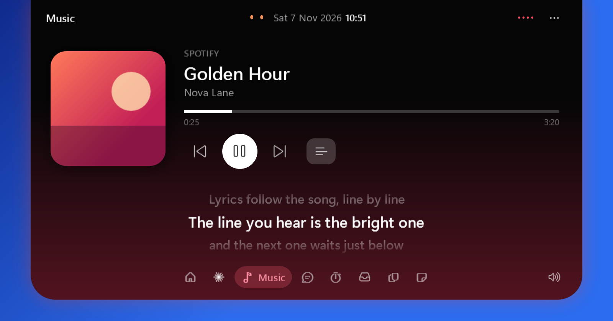
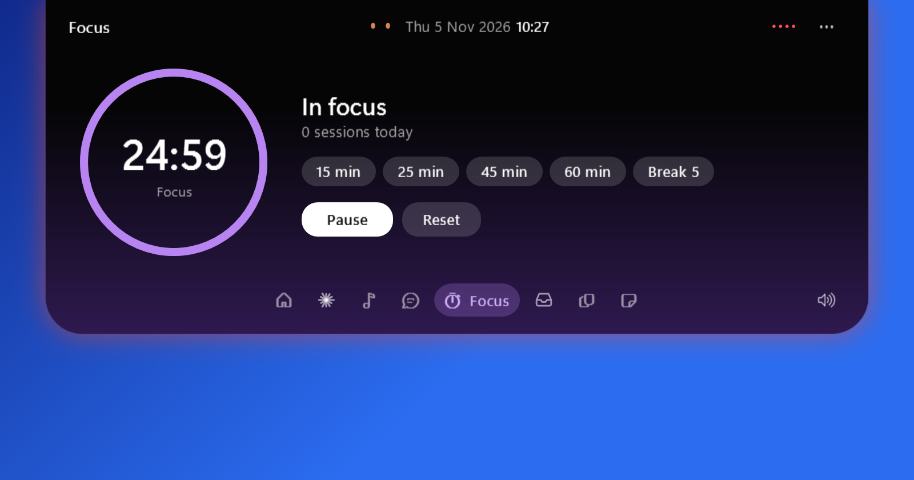
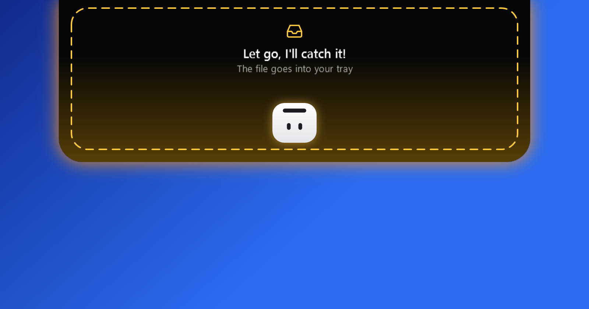

# Island

A Dynamic Island for Windows 10 and 11, written in C# with WPF on .NET 9. It sits at the top of the screen as a
small pill, opens on hover (or Ctrl+Alt+T) and gives quick access to:

- **Claude Code**: live status of running sessions (current step and elapsed time), and "Ask Claude" to start a
  prompt in a chosen folder
- **Music**: now playing and media controls for any player that reports to Windows (Spotify, browsers), with
  synced lyrics that follow the song. Lyrics come from [LRCLIB](https://lrclib.net), a free lyrics database; only
  the song's title, artist, album and length are sent. The lyrics button in the Music tab turns them off.
- **Focus timer** with presets
- **File tray**: drop files on the island to park them; send files from a phone on the same network (QR code,
  one-hour link)
- **Clipboard history** (kept in memory only) and **quick notes**



| Music | Focus | Drop a file |
| --- | --- | --- |
|  |  |  |

## Build

Requires the .NET 9 SDK on Windows.

```powershell
dotnet publish src/Island.csproj -c Release -r win-x64 --self-contained -p:PublishSingleFile=true `
  -p:IncludeNativeLibrariesForSelfExtract=true -p:EnableCompressionInSingleFile=true -o publish
```

`IncludeNativeLibrariesForSelfExtract` matters: without it WPF's native DLLs (`*_cor3.dll`) are written next to
`Island.exe`, and a copy of the exe alone crashes with `DllNotFoundException` the first time WPF hooks a window.

## Run

- `Island.exe`: Ctrl+Alt+T toggles the island; quit from the tray icon. Settings and notes live in `%APPDATA%\Island`.
- **Start with Windows**: tick it in the island's settings menu (the ⋯ button) or the tray icon menu. It adds a
  per-user entry (no administrator needed) and also clears a "Disabled" set for Island in Task Manager.
- `Island.exe --shots <folder>`: renders every state to PNG, off screen.
- `Island.exe --selftest <log> [--online]`: runs the built-in checks; the exit code is the number of failures.
  `--online` also checks that LRCLIB answers.

The phone transfer listens on the computer's local network address; on first start Windows asks to allow it through
the firewall (allow it for private networks).

Animations run at 50 fps and the idle loops at 12 fps, with software rendering, to keep CPU and memory low
(about 65 MB).
